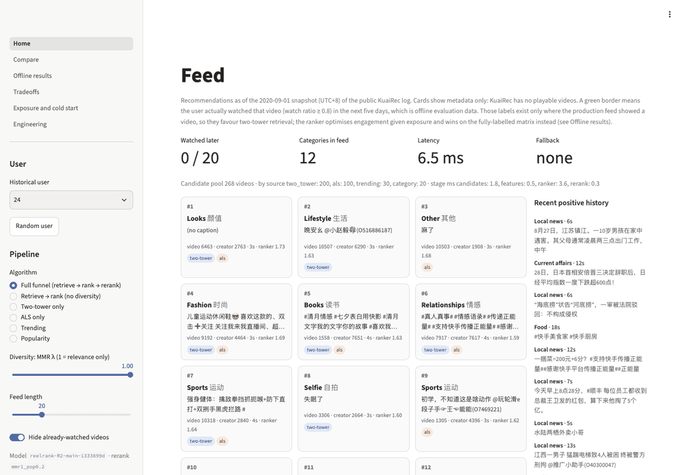
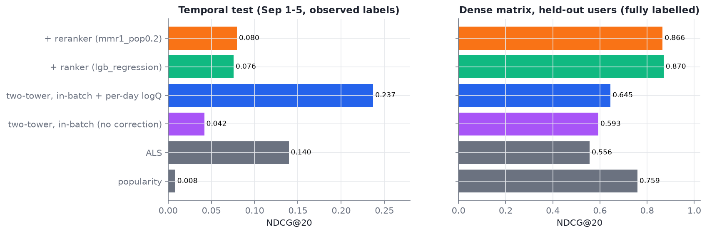
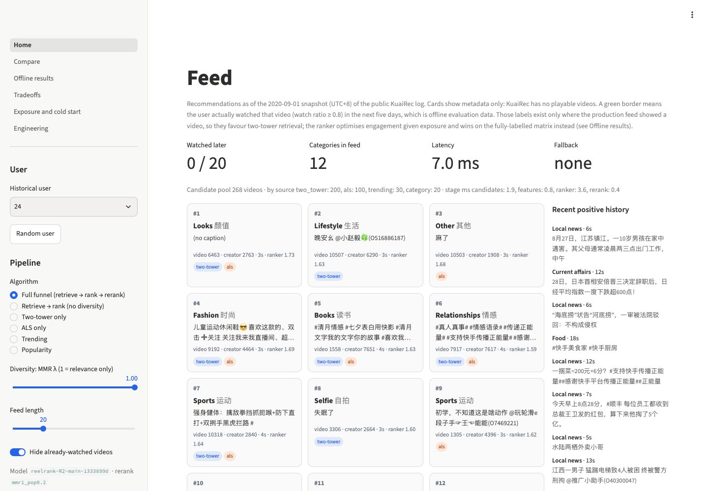
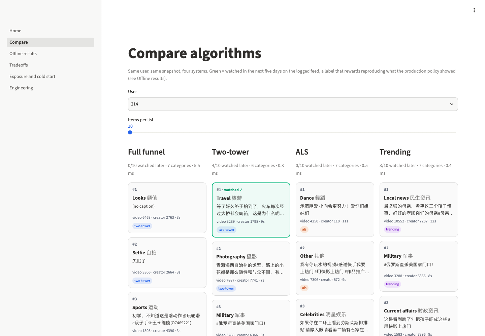
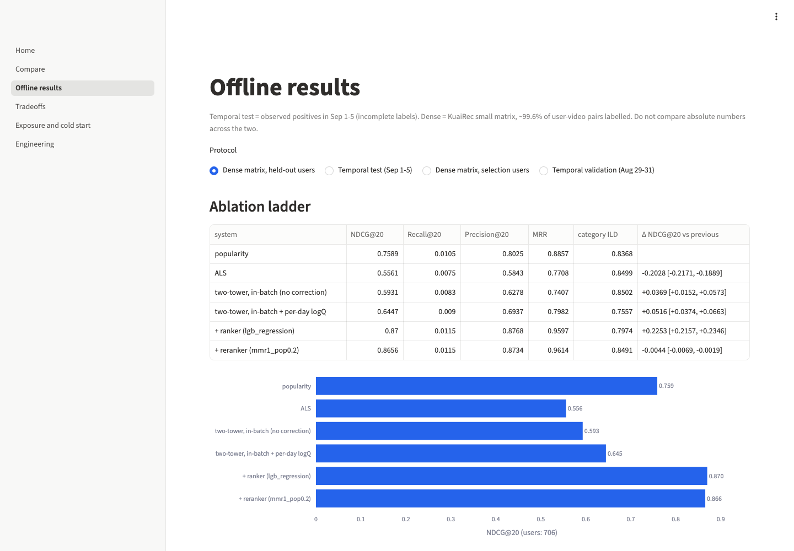
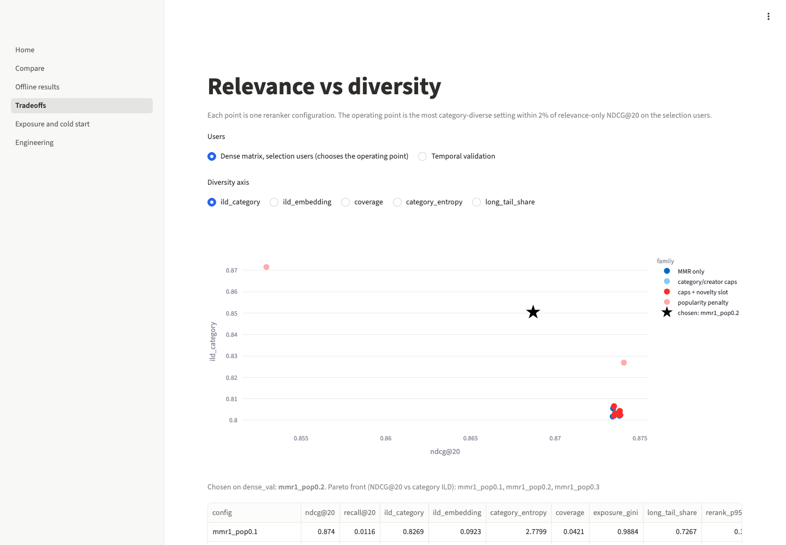
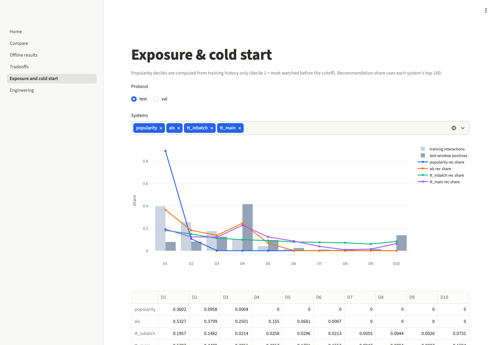
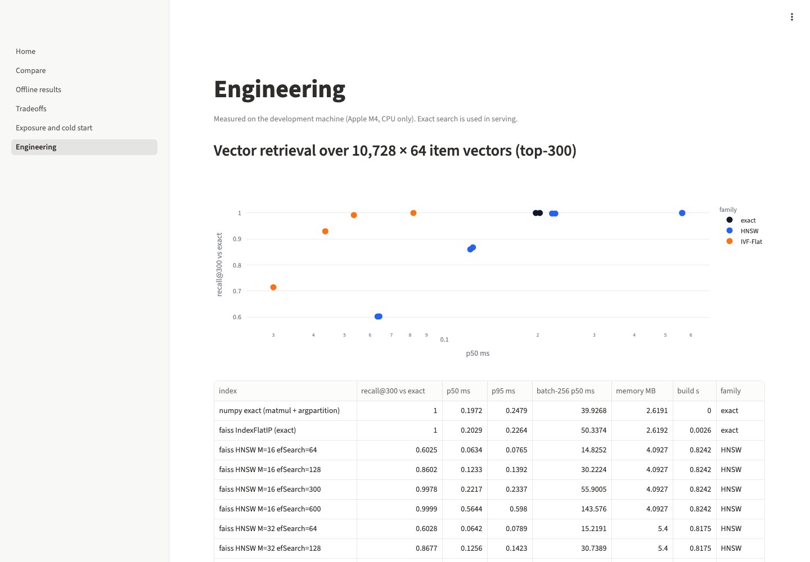
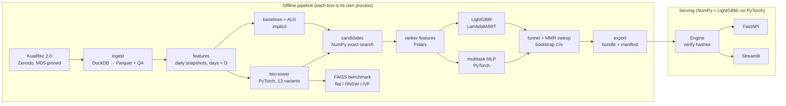

# ReelRank

A multi-stage short-video recommender built on KuaiRec, a public log from the Kuaishou app: 11.6M de-duplicated
interactions between 7,176 users and 10,728 videos, plus a 99.6%-dense evaluation matrix. It retrieves candidates with a
PyTorch two-tower model and ALS, ranks them with LightGBM (LambdaMART and pointwise variants, plus a multitask neural
ranker; validation picked pointwise), then reranks for diversity with MMR, category/creator caps and a popularity penalty. Evaluation is leakage-safe: models train only on days before each
cutoff, and every comparison carries a paired bootstrap interval.

Project page: [omkar-ku1karni.github.io/reelrank](https://omkar-ku1karni.github.io/reelrank/)

It follows the publicly described shape of large feed recommenders (retrieve -> rank -> rerank). It is an offline
research prototype: it does not reproduce any company's system, there is no live traffic, and offline gains are not
evidence of watch-time or retention uplift.



## Results

<!-- RESULTS:START -->
|  |  |
|---|---|
| Events processed | 11,562,801 real interactions (968,004 duplicate rows removed), 7,176 users x 10,728 videos |
| Retrieval, temporal test Recall@100 | two-tower 0.2980 vs ALS 0.2255, trending 0.1603, popularity 0.0285: Δ vs ALS +0.0726 [+0.0696, +0.0754] (32.2% relative) |
| Sampling-bias correction (val Recall@100) | no correction 0.0722, global logQ 0.0819, per-day logQ 0.2857 |
| Funnel NDCG@20, temporal test | retrieval 0.2370 -> + ranker 0.0757 (Δ -0.1613 [-0.1647, -0.1582]) -> + reranker 0.0795 (Δ +0.0039 [+0.0032, +0.0045], category ILD 0.846 -> 0.835) |
| Funnel NDCG@20, dense matrix, held-out users | retrieval 0.6447 -> + ranker 0.8700 (Δ +0.2253 [+0.2157, +0.2346]) -> + reranker 0.8656 (Δ -0.0044 [-0.0069, -0.0019], category ILD 0.797 -> 0.849) |
| Final feed, temporal test | catalog coverage@20 4.9%, exposure Gini 0.993, long-tail share 89.1% |
| Cold-start videos (480 held-out IDs), Recall@20 within the cold catalog | metadata tower 0.0800 vs random 0.0417 vs ID-only 0.0276 |
| Serving latency (full funnel, offline replay) | p50 5.0 ms, p95 5.9 ms over 6,989 requests |
| Exact vector search | top-300 over 10,728 items: p50 0.197 ms |

The ranker helps on the dense matrix and hurts on the temporal test, and that is the main finding. Rankers trained on logged impressions learn engagement *given exposure*. The dense matrix has every video shown to every user, so it measures that directly; temporal labels exist only where the production feed chose to show a video, so they also reward predicting the logging policy. Ranker and reranker are selected on half of the dense users and reported on the other half ([report, Section 10](reports/research_report.md)).

Confidence intervals are 95% paired user bootstraps. Temporal metrics count only observed positives; dense-matrix metrics use a ~99.6%-labelled user x video matrix. The two are never compared in absolute terms.



<!-- RESULTS:END -->

Full write-up with every table, ablation and caveat: [reports/research_report.md](reports/research_report.md).

| Feed | Algorithm comparison | Offline results |
|---|---|---|
|  |  |  |
| Relevance vs diversity | Exposure & cold start | Engineering |
|  |  |  |

## What is in here

| Stage | Implementation |
|---|---|
| Ingest + QA | DuckDB reads the CSVs, removes 968,004 exact duplicate rows, writes date-partitioned Parquet and a QA report |
| Features | Daily user/item snapshots from strictly earlier days (Polars + NumPy), a DuckDB window-function rolling feature, lagged platform statistics; leakage checked by brute-force tests |
| Baselines | random, popularity, trending, category affinity, item-item cosine, implicit ALS (tuned; recency-decayed confidence) |
| Two-tower | PyTorch user tower (ID + pooled/GRU/SASRec history + stats + category affinity) and item tower (ID + category/tag/creator/duration + lagged popularity), 256->128->64, L2-normalised, in-batch softmax with per-day logQ correction; 13 variants (negative samplers, ID-only, temperature, sequence encoders, cold-start holdouts) |
| Candidates | union of two-tower top-200, ALS top-100, trending 30, favourite-category 20, with source flags; pool recall reported before ranking |
| Ranking | LightGBM LambdaMART (graded relevance, user-day queries) + pointwise and feature ablations; multitask MLP (watch-time Huber, completion and skip BCE) with a validation-tuned utility, calibration and duration-bias analysis |
| Reranking | MMR with category caps, creator caps, a long-tail novelty slot and a popularity penalty; operating point picked on the validation Pareto front |
| Evaluation | temporal (observed labels) and dense (fully labelled) protocols, ablation ladder, paired user bootstrap CIs, exposure by popularity decile, cold-start items and low-history users, post-gap robustness |
| Vector search | exact NumPy and FAISS IndexFlatIP vs HNSW and IVF sweeps: recall vs exact, p50/p95, memory, build time |
| Serving | FastAPI (`/recommendations`, `/videos/{id}/similar`, `/models/metrics`, `/feedback`) over a hash-pinned bundle; refuses mismatched model/index versions; NumPy forward pass of the towers |
| App | Streamlit: feed, algorithm comparison, offline results, relevance/diversity tradeoffs, exposure & cold start, engineering |
| Tracking | local MLflow (SQLite) for every training run |

## Architecture



Request path: user vector (NumPy tower over the snapshot) -> exact top-k from two-tower and ALS + trending and category
pools -> LightGBM over the shared feature schema -> MMR with caps -> cards with retrieval sources, predicted engagement
and model version.

## Quick start

Requires Python 3.11–3.12, [uv](https://docs.astral.sh/uv/) and about 4 GB of free disk. No API keys, no GPU.

```bash
git clone https://github.com/omkar-ku1karni/reelrank.git && cd reelrank
make all      # install, download KuaiRec (~432 MB, MD5-checked), run every stage (~2 h on an Apple M4 CPU)
make test     # 62 tests in three processes (LightGBM / PyTorch / FAISS sides)
make demo     # Streamlit on http://localhost:8501
make api      # FastAPI on http://localhost:8000/docs
make smoke    # the same pipeline on a synthetic KuaiRec-shaped fixture (~2 min; what CI runs)
```

`make help` lists every stage; each one can be re-run on its own (`make baselines`, `make funnel`, ...). `make mlflow-ui`
opens the training runs. A `Dockerfile` and `docker-compose.yml` are included (`docker compose run --rm pipeline`,
then `docker compose up api app`); the image builds in CI but was not run locally because Docker isn't running on the
development Mac.

```bash
curl 'localhost:8000/recommendations/42?k=10&explain=true'
curl 'localhost:8000/videos/3649/similar?k=5'
curl -X POST localhost:8000/feedback -H 'content-type: application/json' \
     -d '{"user_id": 42, "video_id": 3649, "event": "complete", "watch_ratio": 1.1}'
```

## Design decisions

Evaluation windows follow the data, not the calendar. The big matrix is three bursts (Jul 5–12, Aug 1–10,
Aug 27–Sep 5) with multi-week gaps. A validation cutoff right after a 16-day gap made every method look random
(popularity scored *below* random), while the test cutoff sits inside a burst. Validation and test are therefore both
in-burst (Aug 29–31, Sep 1–5). The post-gap cutoff is kept as a separate robustness protocol.

The logQ correction has to use the sampler you actually have. Training batches come from a single day, so in-batch
negatives follow *that day's* item frequency. The textbook correction with global frequencies did nothing
(validation Recall@100 ~ 0.08, the same as no correction). Correcting with the per-day frequency more than tripled it.
Both versions are kept as ablations.

Select on labels that are not exposure-confounded. Temporal labels exist only for videos the production feed
showed, so temporal NDCG rewards reproducing the logging policy. Selecting the ranker on temporal validation picked
"no ranker". Ranker and reranker are therefore selected on a seeded half of the fully-labelled dense users and
reported on the other half. The temporal numbers are still reported, including the ranker's drop there. The report
records that the rule changed and why.

The label is duration-biased, and the ranker noticed. Median watch ratio is 1.8 for videos under 5 s and 0.08 at
60–120 s, so `watch_ratio >= 0.8` mostly marks short videos as positive. Video length carries 70% of LambdaMART's gain,
and the served feed leans toward 3–4 s clips. A production system would use a duration-normalised engagement label;
I've kept the effect visible and reported it.

Recency beats capacity. ALS with a 7-day half-life on confidence weights beat every un-decayed ALS setting on
validation by roughly 4x. The two-tower samples training positives with the same half-life. Right after a 16-day gap in the
log every method drops sharply (Recall@100: two-tower 0.29 -> 0.09, ALS 0.17 -> 0.03, popularity at or below random),
because most videos watched then are new.

Exact search, measured. 10,728 x 64 vectors fit in 2.6 MB, and exact top-300 takes well under a millisecond. FAISS
HNSW and IVF are benchmarked against exact search as an engineering experiment, not used in serving.

Process isolation. On macOS the PyTorch, FAISS and LightGBM wheels each bundle their own OpenMP runtime. Measured
on the development machine: torch + FAISS segfaults, torch + LightGBM segfaults or deadlocks, and FAISS + LightGBM
deadlocks (implicit/ALS is safe with all three). Each pipeline stage therefore runs as its own process and passes
`.npy`/Parquet files. Serving runs the two-tower as a NumPy forward pass, checked against PyTorch to 1e-4 at export.
`reelrank.runtime.claim()` raises a clear error instead of letting a process crash, and the tests run as three
separate pytest processes.

Never call the unobserved a negative. Rankers train only on observed plays with known outcomes. Unobserved
retrieved candidates are not labelled as skips. On the temporal protocol, unobserved pairs simply earn no gain, so those
metrics are observed-positive metrics and are reported separately from the dense matrix.

## Data

[KuaiRec 2.0](https://kuairec.com/) (Gao et al., *KuaiRec: A Fully-observed Dataset and Insights for Evaluating
Recommender Systems*, CIKM 2022), downloaded from [Zenodo record 18164998](https://zenodo.org/records/18164998)
(listed there as CC BY 4.0; the GitHub repository states CC BY-SA 4.0) and verified by MD5. The data is not
redistributed here. KuaiRec contains no playable videos, so the app shows metadata cards (category, caption, creator,
duration), never video clips. Captions and category names are in Chinese. The English category names are my own
glosses.

Problems found and handled (details in the report): 968,004 exact duplicate rows (concentrated on Aug 5 and Aug 31);
a `date` column that disagrees with the timestamp on 15,530 rows; 181,992 dense-matrix rows without timestamps (used
as labels only); 4 malformed caption rows; 8.8% of videos watched before their listed upload date; and a positive
label (`watch_ratio >= 0.8`) that is strongly duration-biased.

## Repository layout

```
src/reelrank/
  data/ingest.py          download + DuckDB ingest + QA
  features/build.py       daily snapshots, evaluation targets
  retrieval/              baselines, two_tower (PyTorch), evaluate, candidates, faiss_bench
  ranking/                dataset (shared feature schema), lgb_ranker, neural (multitask), metrics
  reranking/mmr.py        MMR + caps + novelty slot + popularity penalty
  evaluation/             protocol, metrics, funnel (ladder + Pareto), eda, report
  serving/                export (bundle + manifest), engine, api, numpy_model, simulate
  runtime.py              OpenMP process-isolation guard
app/                      Streamlit (6 pages)
configs/                  kuairec.yaml (real data), smoke.yaml (fixture)
tests/                    unit + contract tests; tests/torch_tests, tests/faiss_tests run in their own processes
reports/                  research_report.md, figures/, metrics/*.json, screenshots/, demo.gif
artifacts/manifest.json   hashes and versions of the served bundle
```
