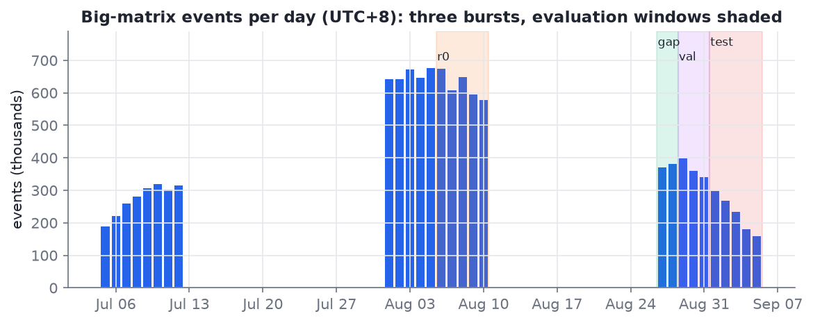
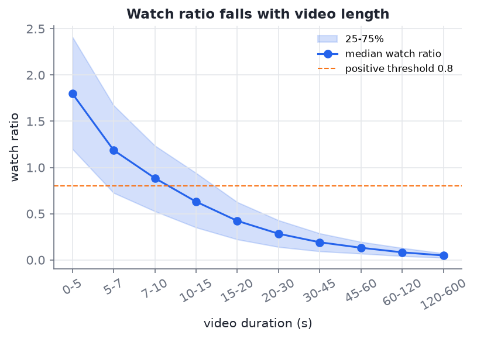
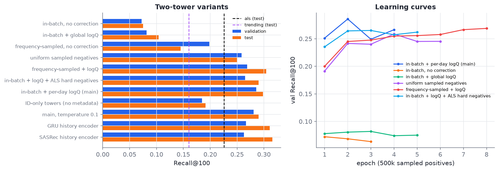
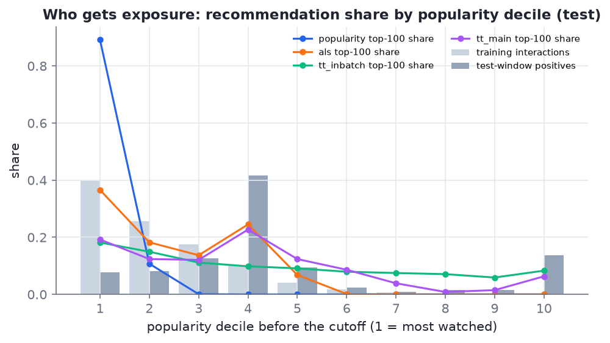
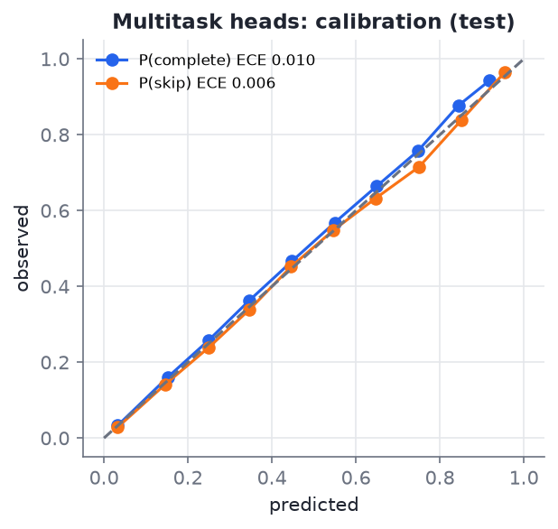
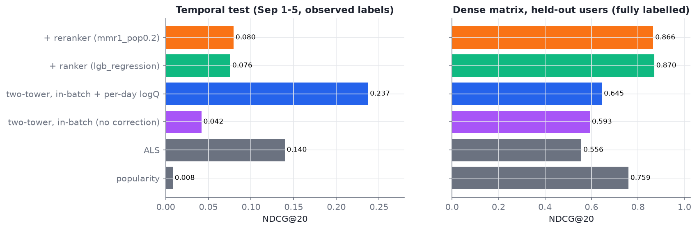
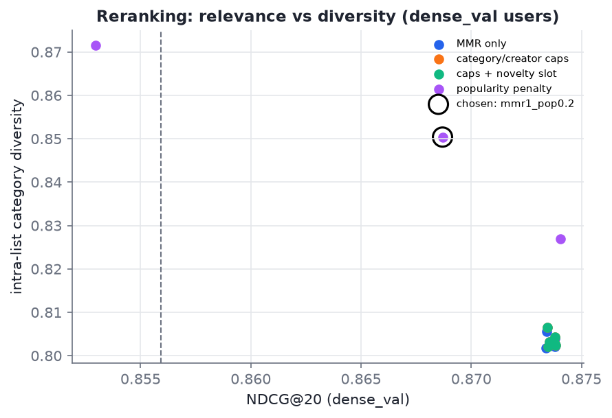
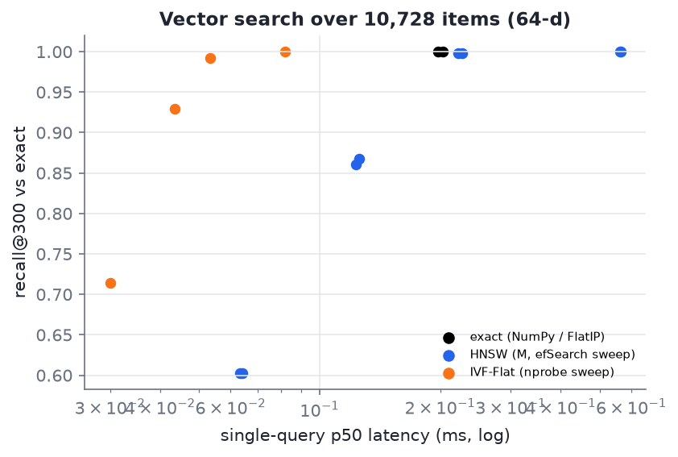

# ReelRank: research report

_Generated by `make report` from persisted metrics. Config `kuairec` (hash `40a49b83c34b`). All results are offline: there is no live traffic, and offline gains do not prove retention or watch-time uplift._

## 1. Summary

|  |  |
|---|---|
| Events processed (after de-duplication) | 11,562,801 of 12,530,806 raw rows |
| Users x videos | 7,176 x 10,728 |
| Recall@100, two-tower (main) vs ALS, temporal test | 0.2980 vs 0.2255: Δ +0.0726 [+0.0696, +0.0754] (paired user bootstrap, 6,852 users) |
| Recall@100, two-tower vs trending, temporal test | Δ +0.1378 [+0.1344, +0.1413] |
| NDCG@20 change from adding the ranker after two-tower retrieval (temporal test) | 0.2370 -> 0.0757: Δ -0.1613 [-0.1647, -0.1582] |
| NDCG@20 change from the diversity reranker (temporal test) | +0.0039 [+0.0032, +0.0045]; category ILD 0.846 -> 0.835 |
| NDCG@20 change from adding the ranker after two-tower retrieval (dense matrix, held-out users) | 0.6447 -> 0.8700: Δ +0.2253 [+0.2157, +0.2346] |
| NDCG@20 change from the diversity reranker (dense matrix, held-out users) | -0.0044 [-0.0069, -0.0019]; category ILD 0.797 -> 0.849 |
| Catalog coverage@20 / exposure Gini (test, final feed) | 4.9% / 0.993 |
| Exact retrieval latency (single query, top-300) | p50 0.197 ms, p95 0.248 ms over 10,728 items |

## 2. Data and quality checks

KuaiRec 2.0 (Gao et al., CIKM 2022; Zenodo record 18164998, MD5-verified). The big matrix logs a production feed: 12,530,806 raw rows. Checks on it:

- 968,004 exact duplicate rows (7.7%) were removed; the heaviest days are 2020-08-05 (624,313), 2020-08-31 (340,558), 2020-08-06 (343). 1 more rows shared (user, video, timestamp) with a different play time and were collapsed.
- No missing timestamps, negative play times or non-positive durations; watch ratio equals play/duration on every row. 33.8% of rows have watch ratio > 1 (replays).
- 1,261,832 events are repeat views of an already-watched video. The main task is novel-item recommendation; repeat share of positives is reported per window.
- The `date` column disagrees with the Unix timestamp on 15,530 rows; calendar days come from the timestamp (UTC+8).
- Events fall on 28 busy days in three bursts separated by multi-week gaps (figure below).
- Small matrix: 4,676,570 rows, 1,411 users x 3,327 videos, density 99.6%; 181,992 rows have no timestamp (kept as labels). 0 pairs overlap the big matrix, so dense evaluation cannot leak through training pairs.
- 4 caption rows were malformed and dropped; every video still has metadata. 8,369 creators (creator IDs exist, so the reranker can cap per-creator repetition).
- 45.8% of videos are first watched on their upload day, and 8.8% are watched *before* their listed upload date, so upload dates are used for eligibility only together with observed views.
- Item exposure Gini 0.67; the top 10% of videos take 40.5% of interactions. Watch ratio falls steeply with duration (median 1.80 under 5 s vs 0.08 at 60-120 s), so `watch_ratio >= 0.8` favours short videos.

## 3. Evaluation protocol

| window | dates (UTC+8) | model | users | novel positive pairs | repeat share of positives | eligible videos | positives on not-yet-eligible videos |
|---|---|---|---|---|---|---|---|
| r0 | 2020-08-06 -> 2020-08-10 | R0 | 6,713 | 1,099,150 | 5.5% | 6,912 | 184,938 |
| gap | 2020-08-27 -> 2020-08-28 | RG | 6,811 | 240,215 | 20.5% | 8,771 | 23,366 |
| val | 2020-08-29 -> 2020-08-31 | R1 | 6,850 | 363,381 | 16.7% | 9,164 | 30,686 |
| test | 2020-09-01 -> 2020-09-05 | R2 | 6,852 | 358,528 | 10.8% | 9,721 | 73,023 |

- Each model family trains only on days strictly before its window. R0 scores the ranker's training window, R1 is used for every selection decision, R2 is trained once with the selected settings and is the only model evaluated on test and on the dense matrix. The retrieval variant is selected on temporal validation; the ranker and reranker on half of the dense users (Section 10). The test window and the other dense half were read after selection.
- A feature snapshot for day *d* summarises events from days < *d*; same-day events never see each other, which resolves timestamp ties conservatively. Daily platform statistics become visible the day after they are dated.
- Positive = watch ratio >= 0.8 (a proxy, not intent). Graded relevance for NDCG: 0 skip (< 0.2), 1 partial, 2 high watch (>= 0.8), 3 completion (>= 1.0). Unobserved pairs are not negatives; on the temporal protocol they simply earn no gain, so temporal metrics are observed-positive metrics with incomplete labels.
- Temporal and dense numbers answer different questions and are never compared in absolute terms.
- Uncertainty: paired user bootstrap (1,000 resamples) over the users both systems were evaluated on.

## 4. Retrieval

| system | val R@100 | test R@50 | test R@100 | test R@300 | test NDCG@20 | test coverage@20 | dense P@20 | dense NDCG@20 |
|---|---|---|---|---|---|---|---|---|
| random | 0.0129 | 0.0059 | 0.0121 | 0.0357 | 0.0066 | 1.0000 | 0.4738 | 0.4492 |
| popularity | 0.0253 | 0.0121 | 0.0285 | 0.0780 | 0.0082 | 0.0438 | 0.8037 | 0.7595 |
| trending | 0.1037 | 0.0854 | 0.1603 | 0.3671 | 0.1021 | 0.0148 | 0.4488 | 0.3931 |
| category | 0.0247 | 0.0152 | 0.0306 | 0.0799 | 0.0132 | 0.1031 | 0.7128 | 0.6724 |
| itemknn | 0.0551 | 0.0394 | 0.0849 | 0.2448 | 0.0386 | 0.0590 | 0.8291 | 0.7887 |
| als | 0.1701 | 0.1441 | 0.2255 | 0.4008 | 0.1395 | 0.1603 | 0.5836 | 0.5544 |
| in-batch, no correction | 0.0722 | 0.0474 | 0.0750 | 0.1559 | 0.0418 | 0.2321 | 0.6301 | 0.5964 |
| in-batch + global logQ | 0.0819 | 0.0640 | 0.1041 | 0.2247 | 0.0552 | 0.1474 | 0.6660 | 0.6082 |
| uniform sampled negatives | 0.2586 | 0.1386 | 0.2501 | 0.5314 | 0.1011 | 0.0789 | 0.5946 | 0.5727 |
| frequency-sampled, no correction | 0.1987 | 0.0834 | 0.1450 | 0.3738 | 0.1186 | 0.0584 | 0.6457 | 0.6012 |
| frequency-sampled + logQ | 0.2688 | 0.1894 | 0.3041 | 0.5614 | 0.2057 | 0.0847 | 0.6710 | 0.6080 |
| in-batch + logQ + ALS hard negatives | 0.2650 | 0.1872 | 0.2901 | 0.5568 | 0.2163 | 0.0661 | 0.6769 | 0.6417 |
| in-batch + per-day logQ (main) | 0.2857 | 0.2004 | 0.2980 | 0.5568 | 0.2370 | 0.0568 | 0.6953 | 0.6423 |
| main, temperature 0.1 | 0.2810 | 0.1884 | 0.2899 | 0.5467 | 0.1948 | 0.0561 | 0.7464 | 0.7119 |
| ID-only towers (no metadata) | 0.1849 | 0.1282 | 0.1913 | 0.3529 | 0.1611 | 0.0501 | 0.4906 | 0.4418 |
| GRU history encoder | 0.2665 | 0.2004 | 0.3108 | 0.5755 | 0.2115 | 0.0618 | 0.7199 | 0.6565 |
| SASRec history encoder | 0.2628 | 0.2099 | 0.3157 | 0.5954 | 0.2256 | 0.0516 | 0.7150 | 0.6602 |

ALS was tuned on validation: 32 factors, regularization 0.01, alpha 1.0, recency half-life 7 days. Recency weighting was the single largest ALS effect: see `reports/metrics/als_tuning.json` (every half-life-7 setting beats every un-decayed one on validation).

On the temporal test, the selected two-tower (in-batch + per-day logQ (main)) beats ALS on Recall@100: Δ +0.0726 [+0.0696, +0.0754] (32.2% relative).
- Dense matrix, NDCG@20 two-tower - popularity: -0.1172 [-0.1242, -0.1094].
- Dense matrix, NDCG@20 two-tower - itemknn: -0.1465 [-0.1532, -0.1392].
- Dense matrix, NDCG@20 two-tower - als: +0.0878 [+0.0793, +0.0974].

## 5. Negative sampling and the sampling-bias correction

Training batches are drawn from a single day so in-batch negatives share that day's item features. That makes the in-batch sampling distribution the day's item frequency, not the global one. Subtracting log q with the actual (per-day) distribution is what makes in-batch training work here:

| negatives | val R@100 | test R@100 | test long-tail share@20 | test coverage@20 |
|---|---|---|---|---|
| in-batch, no correction | 0.0722 | 0.0750 | 0.6085 | 0.2321 |
| in-batch + global logQ | 0.0819 | 0.1041 | 0.1315 | 0.1474 |
| in-batch + per-day logQ (main) | 0.2857 | 0.2980 | 0.5668 | 0.0568 |
| uniform sampled negatives | 0.2586 | 0.2501 | 0.7973 | 0.0789 |
| frequency-sampled, no correction | 0.1987 | 0.1450 | 0.9789 | 0.0584 |
| frequency-sampled + logQ | 0.2688 | 0.3041 | 0.5641 | 0.0847 |
| in-batch + logQ + ALS hard negatives | 0.2650 | 0.2901 | 0.5932 | 0.0661 |

- per-day vs global logQ: test Recall@100 Δ +0.1939 [+0.1913, +0.1966]
- logQ on frequency-sampled negatives: test Recall@100 Δ +0.1591 [+0.1558, +0.1626]
- adding ALS hard negatives: test Recall@100 Δ -0.0079 [-0.0097, -0.0062]

The correction addresses sampling bias in the training objective; it does not remove exposure bias of the logging policy that produced the data.

## 6. Architecture ablations

| variant | val R@100 | test R@100 | dense NDCG@20 | train examples/s | train s (R1) | parameters |
|---|---|---|---|---|---|---|
| in-batch + per-day logQ (main) | 0.2857 | 0.2980 | 0.6423 | 34,060 | 59 | 1,326,824 |
| ID-only towers (no metadata) | 0.1849 | 0.1913 | 0.4418 | 31,718 | 79 | 1,278,016 |
| main, temperature 0.1 | 0.2810 | 0.2899 | 0.7119 | 29,094 | 69 | 1,326,824 |
| GRU history encoder | 0.2665 | 0.3108 | 0.6565 | 3,163 | 631 | 1,351,976 |
| SASRec history encoder | 0.2628 | 0.3157 | 0.6602 | 2,530 | 789 | 1,397,224 |

- tt_main - tt_id_only, test Recall@100: +0.1067 [+0.1044, +0.1092]
- tt_gru - tt_main, test Recall@100: +0.0128 [+0.0113, +0.0143]
- tt_sasrec - tt_main, test Recall@100: +0.0176 [+0.0158, +0.0195]

The sequence encoders were not selected: they scored lower on validation, although they score higher on test. Selection followed validation only. They also cost about 13x the training time of mean pooling on CPU. With more validation data or tuning they are the natural next step.

## 7. Popularity exposure and cold start

| system | top-100 share from decile 1 | share from deciles 6-10 | recall on decile-1 targets | recall on decile-6 targets |
|---|---|---|---|---|
| popularity | 89.2% | 0.0% | 0.3602 | 0.0000 |
| trending | 27.2% | 0.0% | 0.4061 | 0.0000 |
| als | 36.6% | 0.2% | 0.5327 | 0.0007 |
| itemknn | 76.8% | 0.0% | 0.4785 | 0.0000 |
| tt_inbatch | 18.2% | 36.8% | 0.1957 | 0.0213 |
| tt_main | 19.2% | 21.2% | 0.5397 | 0.1553 |
| tt_uniform | 13.0% | 36.9% | 0.3923 | 0.0769 |
| tt_freq | 1.1% | 85.3% | 0.0798 | 0.0606 |
| tt_freq_logq | 18.7% | 13.0% | 0.4972 | 0.1379 |
| tt_hard | 16.8% | 19.5% | 0.4802 | 0.1770 |

Decile 1 holds 39.7% of training interactions and 7.8% of test positives.

Held-out items. 480 items with training history were removed from training and from every user history; their popularity and platform statistics are zeroed at serving time, so only static metadata (tags, category, duration, creator) is left.

| model | Recall@20 within cold catalog | Recall@50 within cold catalog | cold-item Recall@100 (full catalog) | warm-item Recall@100 | cold share of top-100 |
|---|---|---|---|---|---|
| tt_main (items warm) | 0.6819 | 0.9351 | 0.3041 | 0.2962 | 4.8% |
| tt_cold (metadata + unknown id) | 0.0800 | 0.2171 | 0.0000 | 0.2904 | 0.0% |
| tt_cold_id_only (unknown id only) | 0.0276 | 0.1224 | 0.0000 | 0.1939 | 0.0% |
| random order within the cold catalog | 0.0417 | 0.1042 |  |  |  |

480 held-out videos are eligible at the test cutoff. In the full catalog a history-less video never reaches the top 100: the item tower leans on popularity and recency, which a cold video does not have. *Within* the cold catalog, the metadata tower shows whether static features say which new video a user will like; in production that would feed a dedicated fresh-content slot.

Low-history users (test Recall@100 by events before the cutoff; users per cohort: 50-200: 58, 200-1k: 2,287, 1k-3k: 4,358, 3k+: 149)

| system | 50-200 | 200-1k | 1k-3k | 3k+ |
|---|---|---|---|---|
| popularity | 0.0000 | 0.0028 | 0.0411 | 0.0668 |
| trending | 0.1372 | 0.1299 | 0.1754 | 0.1922 |
| category | 0.0191 | 0.0134 | 0.0389 | 0.0590 |
| als | 0.3906 | 0.3152 | 0.1765 | 0.2162 |
| tt_main | 0.4206 | 0.3597 | 0.2633 | 0.3193 |

## 8. Candidate generation

| protocol | mean pool | union recall | two-tower (200) | ALS (100) | trending (30) | category (20) |
|---|---|---|---|---|---|---|
| val | 273 | 0.4443 | 0.4161 | 0.1701 | 0.0449 | 0.0395 |
| test | 263 | 0.4846 | 0.4461 | 0.2255 | 0.0567 | 0.0417 |
| dense | 309 | 0.1166 | 0.0823 | 0.0355 | 0.0091 | 0.0062 |

Union recall is the ceiling for everything downstream: the ranker can only reorder what retrieval found.

## 9. Ranking

Rankers train only on observed events with known outcomes (validation protocol: Aug 6-10 with R0 retrieval scores; test protocol: Aug 29-31 with R1 scores). Unobserved retrieved candidates are never labelled as skips.

Logged impressions (re-order each user-day's observed videos; 32,615 test user-days):

| scorer | val NDCG@20 | test NDCG@20 | test MRR | top-10 watch ratio | top-10 completion | top-10 skip | top-10 mean duration (s) |
|---|---|---|---|---|---|---|---|
| lgb_regression | 0.7917 | 0.8372 | 0.8440 | 1.233 | 50.7% | 10.4% | 9.3 |
| lgb_rank_no_als | 0.7919 | 0.8369 | 0.8424 | 1.232 | 50.8% | 10.4% | 9.3 |
| lgb_rank_no_retrieval | 0.7913 | 0.8368 | 0.8422 | 1.232 | 50.7% | 10.4% | 9.3 |
| lgb_rank | 0.7916 | 0.8366 | 0.8427 | 1.232 | 50.7% | 10.4% | 9.3 |
| lgb_rank_no_tt | 0.7910 | 0.8362 | 0.8422 | 1.232 | 50.7% | 10.4% | 9.3 |
| nn_utility | 0.7893 | 0.8357 | 0.8419 | 1.230 | 50.6% | 10.4% | 9.3 |
| nn_complete_only | 0.7892 | 0.8355 | 0.8418 | 1.231 | 50.6% | 10.4% | 9.3 |
| nn_neg_skip_only | 0.7656 | 0.8249 | 0.8330 | 1.211 | 49.3% | 10.4% | 9.4 |
| two_tower_score | 0.7019 | 0.7623 | 0.7692 | 1.078 | 43.7% | 12.7% | 11.0 |
| nn_watch_only | 0.6300 | 0.7383 | 0.7303 | 1.055 | 42.2% | 14.6% | 14.2 |
| popularity | 0.6660 | 0.7216 | 0.7438 | 1.023 | 39.6% | 13.5% | 11.7 |
| als_score | 0.6020 | 0.6677 | 0.6677 | 0.940 | 35.2% | 16.5% | 14.1 |
| random | 0.5779 | 0.6506 | 0.6291 | 0.925 | 34.1% | 18.4% | 16.0 |
| trending | 0.5605 | 0.6405 | 0.6199 | 0.905 | 33.1% | 18.9% | 16.2 |

LambdaMART gain importance (top 8): `i_log_dur` 0.58, `dur_gap` 0.13, `i_mean_wr` 0.08, `u_skip_rate` 0.05, `u_std_wr` 0.04, `i_complete_rate` 0.03, `u_pref_log_dur` 0.02, `u_log_pos` 0.01.

Multitask neural ranker. Utility = 0.0*z(watch) + 0.5*P(complete) - 0.5*P(skip), weights chosen on validation NDCG@20. The utility is a ranking score, not a probability.
Calibration on test: P(complete) ECE 0.010 (base rate 32.2%), P(skip) ECE 0.006 (base rate 18.5%).
Duration. Mean length of the top-10 observed videos: 14.2 s when ranked by predicted watch *time*, 9.3 s by P(complete), 9.3 s by the selected utility; 8.9 s for actual positives and 15.8 s across all observed videos. Watch time rewards length while the watch-ratio label rewards brevity; the validation-chosen utility puts zero weight on watch time.

## 10. End-to-end funnel and ablation ladder

Why the two protocols disagree. Each ranker reorders the same retrieval pool (NDCG@20):

| scorer on the candidate pool | temporal val | temporal test | dense val | dense test |
|---|---|---|---|---|
| tt_score | 0.1826 | 0.2370 | 0.6398 | 0.6447 |
| als_score | 0.1212 | 0.1395 | 0.5527 | 0.5561 |
| lgb_rank | 0.0513 | 0.0859 | 0.8730 | 0.8678 |
| lgb_regression | 0.0538 | 0.0757 | 0.8734 | 0.8700 |
| lgb_rank_no_retrieval | 0.0483 | 0.0874 | 0.8728 | 0.8668 |
| nn_utility | 0.0499 | 0.0602 | 0.8701 | 0.8676 |

Rankers trained on logged impressions learn *engagement given exposure*. On the dense matrix every user has been shown every video, and they are by far the best scorers. Temporal labels exist only for videos the production policy chose to show, so temporal NDCG also rewards predicting that *exposure*. Retrieval models trained on what was watched learn it; impression-trained rankers cannot. This is the logging-policy (exposure) bias KuaiRec was built to expose.

Selection rule. Ranker and reranker are selected on dense_val: half of the fully-labelled small-matrix users. Temporal labels exist only for videos the production policy chose to show, so temporal NDCG rewards reproducing that exposure; the first version of this rule selected on temporal validation and picked 'no ranker' for that reason. The dense users are split by a fixed seed: 705 for selection (`dense_val`), 706 reported only (`dense_test`). Selected ranker: `lgb_regression` (on `dense_val`).

test (6,852 users)

| system | NDCG@20 | Recall@20 | Precision@20 | category ILD | Δ NDCG@20 vs previous [95% CI] |
|---|---|---|---|---|---|
| popularity | 0.0082 | 0.0028 | 0.0104 | 0.825 |  |
| ALS | 0.1395 | 0.0760 | 0.1306 | 0.856 | +0.1313 [+0.1288, +0.1341] |
| two-tower, in-batch (no correction) | 0.0418 | 0.0255 | 0.0368 | 0.692 | -0.0977 [-0.1002, -0.0953] |
| two-tower, in-batch + per-day logQ | 0.2370 | 0.1184 | 0.2108 | 0.743 | +0.1952 [+0.1919, +0.1986] |
| + ranker (lgb_regression) | 0.0757 | 0.0357 | 0.0826 | 0.846 | -0.1613 [-0.1647, -0.1582] |
| + reranker (mmr1_pop0.2) | 0.0795 | 0.0398 | 0.0874 | 0.835 | +0.0039 [+0.0032, +0.0045] |

dense_test (706 users)

| system | NDCG@20 | Recall@20 | Precision@20 | category ILD | Δ NDCG@20 vs previous [95% CI] |
|---|---|---|---|---|---|
| popularity | 0.7589 | 0.0105 | 0.8025 | 0.837 |  |
| ALS | 0.5561 | 0.0075 | 0.5843 | 0.850 | -0.2028 [-0.2171, -0.1889] |
| two-tower, in-batch (no correction) | 0.5931 | 0.0083 | 0.6278 | 0.850 | +0.0369 [+0.0152, +0.0573] |
| two-tower, in-batch + per-day logQ | 0.6447 | 0.0090 | 0.6937 | 0.756 | +0.0516 [+0.0374, +0.0663] |
| + ranker (lgb_regression) | 0.8700 | 0.0115 | 0.8768 | 0.797 | +0.2253 [+0.2157, +0.2346] |
| + reranker (mmr1_pop0.2) | 0.8656 | 0.0115 | 0.8734 | 0.849 | -0.0044 [-0.0069, -0.0019] |

Retrieval-only rows rank the full eligible catalog; ranker rows reorder the shared candidate union. All rows use the same eligibility (novel, already-uploaded videos) and relevance definition.

## 11. Reranking: relevance versus diversity

Operating point chosen on `dense_val`: mmr1_pop0.2 (the most category-diverse configuration within 2.0% of relevance-only NDCG@20).
| protocol | NDCG@20 | category ILD | category entropy (bits) | coverage@20 | exposure Gini | long-tail share | rerank p95 (ms) |
|---|---|---|---|---|---|---|---|
| val | 0.0538 -> 0.0704 | 0.867 -> 0.831 | 2.98 -> 2.77 | 5.5% -> 4.6% | 0.989 -> 0.991 | 77.7% -> 86.9% | 0.18 |
| test | 0.0757 -> 0.0795 | 0.846 -> 0.835 | 2.93 -> 2.87 | 5.2% -> 4.9% | 0.992 -> 0.993 | 81.7% -> 89.1% | 0.17 |
| dense_test | 0.8700 -> 0.8656 | 0.797 -> 0.849 | 2.64 -> 2.91 | 4.4% -> 4.0% | 0.988 -> 0.989 | 66.9% -> 79.4% | 0.19 |

More diversity costs some measured relevance, so where to sit on this curve is a product call.

## 12. Robustness: a cutoff right after a 16-day gap

| system | post-gap R@100 (Aug 27-28) | in-burst val R@100 (Aug 29-31) |
|---|---|---|
| random | 0.0139 | 0.0129 |
| popularity | 0.0113 | 0.0253 |
| trending | 0.0240 | 0.1037 |
| itemknn | 0.0201 | 0.0551 |
| als | 0.0319 | 0.1701 |
| tt_main | 0.0864 | 0.2857 |

After a multi-week gap most watched videos are new. Every history-based method drops sharply; the best post-gap system (tt_main) keeps 0.0864 Recall@100 (6.2x random), and popularity falls to 0.0113, below random (0.0139). A feed would need fresh-content retrieval (metadata towers, real-time trending) rather than history alone.

## 13. Engineering

| index | recall@300 vs exact | p50 ms | p95 ms | batch-256 p50 ms | memory MB | build s |
|---|---|---|---|---|---|---|
| numpy exact (matmul + argpartition) | 1.0000 | 0.197 | 0.248 | 39.93 | 2.6 | 0.00 |
| faiss IndexFlatIP (exact) | 1.0000 | 0.203 | 0.226 | 50.34 | 2.6 | 0.00 |
| faiss HNSW M=16 efSearch=64 | 0.6025 | 0.063 | 0.077 | 14.83 | 4.1 | 0.82 |
| faiss HNSW M=16 efSearch=128 | 0.8602 | 0.123 | 0.139 | 30.22 | 4.1 | 0.82 |
| faiss HNSW M=16 efSearch=300 | 0.9978 | 0.222 | 0.234 | 55.90 | 4.1 | 0.82 |
| faiss HNSW M=16 efSearch=600 | 0.9999 | 0.564 | 0.598 | 143.58 | 4.1 | 0.82 |
| faiss HNSW M=32 efSearch=64 | 0.6028 | 0.064 | 0.079 | 15.22 | 5.4 | 0.82 |
| faiss HNSW M=32 efSearch=128 | 0.8677 | 0.126 | 0.142 | 30.74 | 5.4 | 0.82 |
| faiss HNSW M=32 efSearch=300 | 0.9977 | 0.227 | 0.242 | 56.17 | 5.4 | 0.82 |
| faiss HNSW M=32 efSearch=600 | 0.9997 | 0.564 | 0.595 | 143.76 | 5.4 | 0.82 |
| faiss IVF-Flat nlist=100 nprobe=5 | 0.7146 | 0.030 | 0.035 | 6.62 | 2.7 | 0.02 |
| faiss IVF-Flat nlist=100 nprobe=10 | 0.9296 | 0.044 | 0.049 | 9.89 | 2.7 | 0.02 |
| faiss IVF-Flat nlist=100 nprobe=20 | 0.9918 | 0.053 | 0.061 | 12.32 | 2.7 | 0.02 |
| faiss IVF-Flat nlist=100 nprobe=50 | 0.9998 | 0.082 | 0.089 | 19.18 | 2.7 | 0.02 |

Exact search over this catalog takes well under a millisecond per query, so serving uses exact NumPy search; approximate indexes trade recall for speed they are not needed for here. Measured on arm64 / macOS-26.6-arm64-arm-64bit, FAISS 1.16.0, 1 thread(s), warmed, fixed seeds. These numbers say nothing about web-scale serving.

Serving replay (offline simulation). 6,989 requests (test users plus 2% unknown IDs) through the full engine: p50 5.0 ms, p95 5.9 ms, p99 6.1 ms; stage p95 candidates 1.1 ms, features 0.4 ms, ranker 4.2 ms, rerank 0.2 ms; fallback rate unknown_user 2.0%. Drift val -> test: ranker-score PSI 0.015, category-mix JS 0.066 bits, item-exposure JS 0.466 bits; alerts: none.

Process isolation. On macOS the PyTorch, FAISS and LightGBM wheels each bundle an OpenMP runtime. Measured on the development machine: torch+FAISS segfaults, torch+LightGBM segfaults or deadlocks depending on import order, and FAISS+LightGBM deadlocks; implicit (ALS) is safe with all three. Every pipeline stage is therefore its own process, artifacts move as `.npy`/Parquet, serving runs the two-tower as a NumPy forward pass (parity with PyTorch checked at export), and `reelrank.runtime.claim()` refuses to load a conflicting runtime.

## 14. Negative results and caveats

- In-batch negatives with the textbook global logQ correction reach only 0.0819 val Recall@100, no better than no correction (0.0722); same-day batching changes the sampler.
- On the dense matrix, item-kNN beats the two-tower on NDCG@20 (Δ -0.1465 [-0.1532, -0.1392]): the temporal and dense protocols reward different things (recency vs stable taste over a fixed catalog).
- After the 16-day gap every history-based method loses most of its recall, and popularity falls below random (Section 12).
- The ranker's strongest signal is video length: `i_log_dur` and `dur_gap` carry 70.5% of LambdaMART gain. The watch-ratio label rewards short videos (Section 2), so much of the ranking lift is 'shorter first'. Retrieval-score features add almost nothing on logged impressions (NDCG@20 0.8366 with them vs 0.8368 without). A production system would want a duration-normalised engagement label (e.g. watch-ratio percentile within a duration bucket).
- The impression-trained ranker (`lgb_regression`) lowers temporal-test NDCG@20 (0.2370 -> 0.0757) while raising held-out dense NDCG@20 (0.6447 -> 0.8700). Which system 'wins' depends on whether the metric rewards predicting the logging policy's exposure; a production ranker would need an exposure-aware objective (e.g. inverse-propensity weighting with logged propensities, which KuaiRec does not provide).
- KuaiRec has no impressions without plays, so 'skip' means a short play, not a scroll-past.

## 15. Proposed online experiment (not run)

- Design: user-level randomised A/B test, 50/50, control = current production ranker, treatment = ReelRank funnel at the chosen MMR operating point. Randomise on user ID hash; two full weekly cycles minimum.
- Primary metric: watch time per user per day (log-transformed for analysis), with CUPED on the pre-period.
- Secondary: completion rate, sessions per user, 7-day return rate.
- Guardrails: early-skip rate, hides/reports per 1k impressions, creator exposure Gini, share of impressions from new uploads, p95 feed latency. Any guardrail breach blocks launch.
- Power: size the test on the pre-period variance of the primary metric for a 1% minimum detectable effect; check sample-ratio mismatch daily and stop on SRM.
- Offline improvements reported here are *not* evidence of retention or watch-time uplift.

## 16. Reproducibility

`make all` downloads the data, verifies its MD5 and rebuilds every number in this report (~2 h on an Apple M4 CPU). Seeds are fixed in `configs/kuairec.yaml`; every training run is tracked in a local MLflow store (`make mlflow-ui`). `make smoke` runs the identical pipeline on a synthetic fixture in about two minutes.
